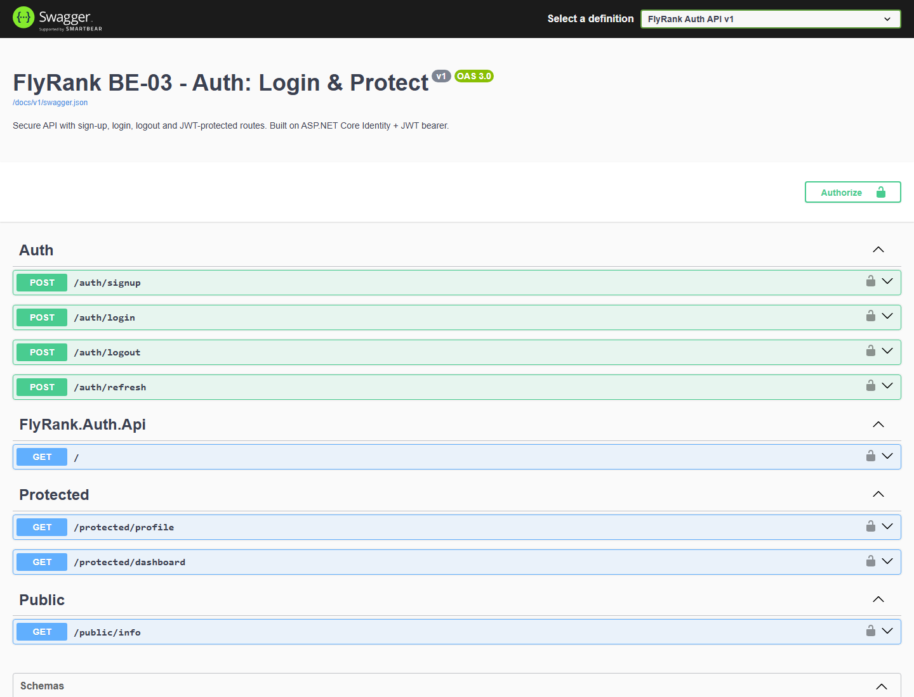

# FlyRank BE-03 — Auth: Login & Protect

A secured authentication API with sign-up, login, logout and JWT-protected routes,
plus a public route, built on **ASP.NET Core (.NET 9)** with **ASP.NET Core Identity**
for password hashing and **JWT bearer** tokens for the protected routes.

> **Stack note:** the built API (`src/FlyRank.Auth.Api`) is **.NET only** and uses
> **no external auth provider** (no Supabase). The `ai-version/` folder is a separate
> **Stage 7 bonus artifact** — an AI-generated draft kept in quarantine for the
> "AI vs me" review. It is not part of the submission and never runs as part of it.

---

## Features

| Area | What it does |
|---|---|
| Auth | Sign up, log in, log out |
| Tokens | JWT access token (HS256) + rotating refresh token |
| Protection | Reusable bearer-token middleware guarding every protected route |
| Public route | `GET /public/info` reachable with no token |
| Roles | An `admin` role gates a route that returns **403** for non-admins |
| Rate limiting | Fixed-window limiter on `/auth/login` returns **429** when hammered |
| Errors | Every 4xx/5xx returns the same shape: `{ "error": "..." }` |
| Docs | Interactive Swagger UI at **`/docs`** |

---

## Requirements

- [.NET SDK 9.0+](https://dotnet.microsoft.com/download)
- EF Core CLI tool (restored automatically from `.config/dotnet-tools.json`)

---

## Setup

```bash
# 1. Install the local EF Core tool (pinned in .config/dotnet-tools.json)
dotnet tool restore

# 2. Create your .env from the template and set a secret
cp .env.example .env        # Windows PowerShell: Copy-Item .env.example .env
# then edit JWT_SECRET to a long random string

# 3. Restore + build
dotnet build FlyRank.Auth.sln
```

`.env` values:

| Key | Purpose |
|---|---|
| `JWT_SECRET` | HMAC signing key for access tokens (required) |
| `ADMIN_EMAILS` | Comma-separated emails that receive the `admin` role (optional; defaults to `admin@example.com`) |

The database (`src/FlyRank.Auth.Api/flyrank_auth.db`, SQLite) is created and migrated
automatically on first run.

---

## Running

```bash
dotnet run --project src/FlyRank.Auth.Api
```

The API listens on **`http://localhost:3000`** and Swagger UI is served at
**`http://localhost:3000/docs`**.

### Swagger UI



Click **Authorize**, paste the raw `access_token` from `/auth/login` (no `Bearer `
prefix), and the protected endpoints become callable from the browser.

---

## API reference

| Method | Path | Auth | Success | Failure |
|---|---|---|---|---|
| `GET` | `/public/info` | none | `200` `{ "message": "Welcome stranger! This info is public." }` | — |
| `POST` | `/auth/signup` | none | `201` user `{ id, email, fullName, createdAt }` | `400` `{ "error": "..." }` |
| `POST` | `/auth/login` | none | `200` `{ access_token, refresh_token, token_type, expires_in, user }` | `401` `{ "error": "Invalid login credentials" }`, `429` if rate-limited |
| `POST` | `/auth/refresh` | refresh token | `200` new token pair | `401` `{ "error": "..." }` |
| `POST` | `/auth/logout` | bearer | `204` | `401` `{ "error": "..." }` |
| `GET` | `/protected/profile` | bearer | `200` `{ id, email, fullName, createdAt, tokenId, issuedAt, expiresAt }` | `401` `{ "error": "..." }` |
| `GET` | `/protected/dashboard` | bearer | `200` `{ message, userId }` | `401` `{ "error": "..." }` |
| `GET` | `/protected/admin` | bearer + `admin` role | `200` `{ message, userId }` | `401` if no/invalid token, **`403`** if not admin |

### Error responses

Every failure uses one shape, so clients only ever parse a single field:

```json
{ "error": "human-readable reason" }
```

This includes automatic model-validation failures (e.g. a missing `password` on
signup), the JWT `OnChallenge`/`OnForbidden` callbacks, the revoked-token middleware,
and the rate-limiter rejection — there is no RFC-7807 `application/problem+json`.

### Example requests

```bash
# Public
curl http://localhost:3000/public/info

# Sign up
curl -X POST http://localhost:3000/auth/signup \
  -H "Content-Type: application/json" \
  -d '{"email":"alice@example.com","password":"Passw0rd!","fullName":"Alice"}'

# Log in (capture the access_token)
curl -X POST http://localhost:3000/auth/login \
  -H "Content-Type: application/json" \
  -d '{"email":"alice@example.com","password":"Passw0rd!"}'

# Call a protected route
curl http://localhost:3000/protected/profile -H "Authorization: Bearer <access_token>"

# Log out (revokes the token)
curl -X POST http://localhost:3000/auth/logout -H "Authorization: Bearer <access_token>"
```

---

## Auth flow

1. **Sign up** — password is hashed by ASP.NET Core Identity (PBKDF2); the user record
   is stored with a `CreatedAt` timestamp.
2. **Log in** — credentials are checked; on success the API issues:
   - a short-lived **access token** (JWT, HS256) carrying `sub`, `jti`, `role`, and expiry;
   - a longer-lived **refresh token** persisted in the database.
3. **Protected request** — the reusable JWT middleware validates the token. Missing
   tokens, malformed tokens, and tampered signatures all return `401`.
4. **Role check** — an authenticated user whose `role` claim is not `admin` is stopped
   by the `AdminOnly` authorization policy with `403`.
5. **Refresh** — `/auth/refresh` rotates the refresh token and mints a new access token.
6. **Log out** — the token's `jti` is added to a revocation store and its refresh token
   is invalidated; a later request with the same token returns `401`.

Full flow: **client → credentials → signed JWT → protected route → verified `claims`**.

---

## Testing

An end-to-end smoke test drives the running API and asserts on **status codes *and*
response bodies**:

```powershell
powershell.exe -ExecutionPolicy Bypass -File scripts/smoke-test.ps1
```

Current result: **14 / 14 checks passed**, covering the exact public message, signup
and its error shape, login / wrong-password, `401` for missing and tampered tokens,
`createdAt` on the profile, the `403` admin gate, logout revocation, and the `429`
rate limit.

---

## Security notes

- **Password hashing:** ASP.NET Core Identity (PBKDF2, per-user salt) — never MD5/plain text.
- **Token verification:** every protected request runs through JWT validation
  (`ValidateIssuerSigningKey`, lifetime, etc.); a tampered signature fails.
- **Strict scheme:** the JWT handler reads the token with an explicit `Bearer `
  prefix check, so a bare token in the `Authorization` header is rejected.
- **No token logging:** tokens are never written to logs.
- **Uniform errors:** all failures collapse to `{ "error": ... }`, avoiding response
  shape or cache differences that can leak state.
- **Config:** the signing secret comes from `.env` (`JWT_SECRET`); `.env` is git-ignored.

### 401 vs 403

| Status | Meaning | Trigger here |
|---|---|---|
| `401 Unauthorized` | *Who are you?* — no/invalid/expired/revoked token | missing header, tampered signature, token used after logout |
| `403 Forbidden` | *I know who you are, but you may not do this* | valid token whose `role` != `admin` on `/protected/admin` |

### Rate limiting (429)

`/auth/login` is limited to **5 requests per minute per IP** (fixed window). Exceeding
it returns `429` with `{ "error": "Too many login attempts. Please try again later." }`.
This blunts password-brute-forcing while leaving the other routes untouched.

---

## Project structure

```
flyrank-be03-auth-login-protect/
├─ FlyRank.Auth.sln
├─ README.md
├─ .env.example
├─ docs/
│  └─ swagger-ui.png
├─ scripts/
│  └─ smoke-test.ps1            # 14 end-to-end assertions
├─ src/FlyRank.Auth.Api/
│  ├─ Program.cs                # wiring: JWT, errors, rate limit, admin policy
│  ├─ Dtos/AuthDtos.cs
│  ├─ Models/AppUser.cs
│  ├─ Services/JwtTokenService.cs
│  ├─ Middleware/RevokedTokenMiddleware.cs
│  ├─ Controllers/{Public,Auth,Protected}Controller.cs
│  └─ Migrations/
└─ ai-version/                  # Stage 7 bonus artifact (NOT the submission)
   ├─ server.js                 # AI first draft (has defects)
   ├─ rematch/server.js         # regenerated after the improved prompt
   ├─ PROMPT.md                 # original + improved prompt
   └─ DIFF.txt                  # git diff --no-index of the two drafts
```

---

## AI vs Me (Stage 7)

### The prompt

> Build a secured authentication API in **Node.js with Express**. Exactly five routes:
> `POST /auth/signup` (`{email,password}` → `201`, `400` if a field is missing),
> `POST /auth/login` (→ `200` + JWT, `401` if wrong), `POST /auth/logout` (protected →
> `204`), `GET /protected/profile` (protected → id+email, `401` if token missing/invalid),
> `GET /public/info` (open → `{ "message": "Welcome stranger! This info is public." }`).
> Read the token from the `Authorization` header, verify it, and put the check in a
> reusable middleware. Same status codes. Keep it short.

### What the AI produced

`ai-version/server.js` — a runnable Express + `jsonwebtoken` app. It returned the right
status codes on the happy path, so at a glance it "worked".

### I ran it and fired my own checkpoints

| Check | AI draft | Should be |
|---|---|---|
| `POST /auth/signup` | `201` | `201` ✅ |
| `POST /auth/login` | `200` + token | `200` ✅ |
| `GET /protected/profile` (valid token) | `200` | `200` ✅ |
| `GET /protected/profile` (**tampered** token) | **`200`** ❌ | `401` |
| `GET /protected/profile` (**no `Bearer` prefix**) | **`200`** ❌ | `401` |
| `GET /protected/profile` (garbage token) | `401` | `401` ✅ |

The two failures are the whole point: a token whose signature I never signed, and a
bare token with no scheme, both sailed through.

### Three written questions

1. **Where did I have to correct the AI's security logic?**
   The AI *decoded* the token (`jwt.decode`) instead of *verifying* it (`jwt.verify`).
   Decoding only parses the Base64 payload — it never checks the signature — so any
   forged token with a valid-looking body was accepted. My checkpoints proved it
   (tampered token → `200`). I switched the draft to `jwt.verify` inside a `try/catch`
   that returns `401` on any failure.
2. **Did the AI need extra guidance for the header/scheme and the 403 route?**
   Yes. It stripped `Bearer ` with `.replace("Bearer ", "")`, which silently leaves a
   bare token untouched — so `Authorization: <token>` was accepted. The improved prompt
   had to say *"require the literal `Bearer ` prefix and reject a bare token"* and
   *"add `GET /protected/admin` returning `403` for non-admins"* explicitly, because
   the first prompt never mentioned either.
3. **What did the AI get right immediately that I kept?**
   The overall skeleton — the five routes, the `{ email, password }` contract, the
   `201`/`400`/`401` status codes, the exact public message, and the idea of a single
   reusable `auth` middleware. That structure is what I kept; only the security and the
   error shape needed fixing.

### Concrete differences (my .NET build vs the AI draft)

1. **Verification:** AI used `jwt.decode` (no signature check) → I use full JWT
   validation; tampered tokens get `401`.
2. **Scheme handling:** AI stripped `Bearer ` with `replace` (accepted bare tokens) →
   I require the exact `Bearer ` prefix.
3. **Password storage:** AI used **MD5** → I use ASP.NET Core Identity **PBKDF2**.
4. **Error shape:** AI sent plain-text bodies → I return `{ "error": "..." }` everywhere.
5. **Token hygiene:** AI `console.log`-ed the token on every request → I never log it.
6. **Logout:** AI's `logout` was a no-op → mine revokes the `jti` and the refresh token,
   so the token stops working.
7. **Extras the AI had none of:** the `403` admin gate, the login **rate limit**, and
   SQLite persistence.

### Rematch

Using the improved prompt (added: verify with `jwt.verify`, strict `Bearer ` parsing,
`bcrypt`/scrypt hashing, no token logging, `{ error }` bodies, and the admin `403` route),
I regenerated the draft as `ai-version/rematch/server.js`. The diff between the two
drafts is captured literally in [`ai-version/DIFF.txt`](ai-version/DIFF.txt).

**One-sentence change:** forcing signature verification plus strict `Bearer ` parsing
turned an API that accepted forged tokens into one that rejects them — the same fix that
a single decode-vs-verify decision forced on the original.
